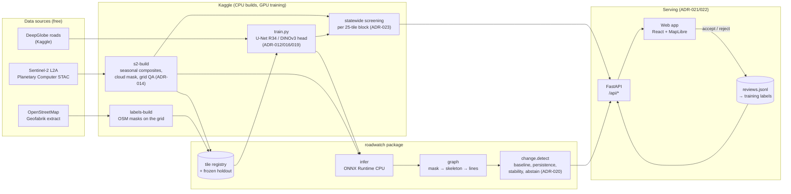
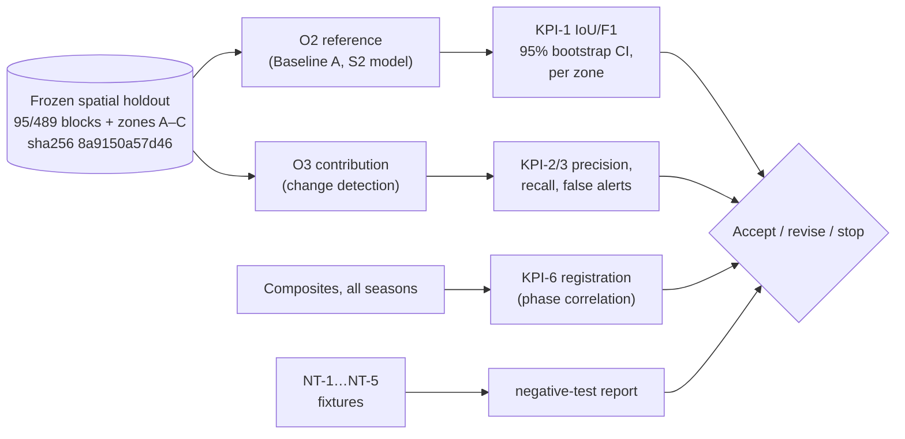

# 03 — Architecture

Version 1.0 (2026-10-18). Decisions behind each part: `DECISIONS.md` (ADR numbers in brackets).

## A. System architecture — what is built and how it connects

| Component | Input → output | Interface / contract | Tests |
|---|---|---|---|
| `data/sentinel2`, `s2-build` | STAC scenes → 4-band uint8 GeoTIFF per tile & season | Deterministic tile id `T{epsg}_{res}m_{size}_{col}_{row}`; registry row with scene ids, cloud, QA | `test_grid`, `test_registry`, NT-4/5 |
| `labels/osm`, `labels-build` | OSM extract → 1-bit road mask per tile | Same tile grid; `has_road`, reserve reasons | `test_labels` |
| `kaggle/baseline_a/train.py` | tiles + masks → checkpoint, ONNX, per-image metrics | `RUN_CONFIG` + config hash; `metrics.json`, `per_image_<split>.csv` | `scripts/smoke_train.py` |
| `models/infer` | ONNX + composites → probability raster | `ModelMeta` (bands, mean/std, threshold) | `test_infer` |
| `graph/extract` | probability → centre-lines with confidence | GeoDataFrame in tile CRS; GeoJSON/GPKG/SHP export | `test_graph`, NT-1, NT-3 |
| `change/detect` | lines per season → new-road candidates | Refuses mixed/geographic CRS and unordered seasons | `test_change`, NT-1…NT-5 |
| `api/app` | files on disk → JSON / images | OpenAPI at `/api/docs`; read-only mode (`ROADWATCH_REVIEWS=browser`) | `test_api` |
| `web/` | API → map, alerts, results | Typed client (`lib/data.ts`) | `tsc`, CI docker smoke test |

## B. Validation architecture — how the result is proven

The same holdout serves the lean build and every later enhancement (Section 14.4), so results stay comparable.

## C. Deployment

| Where | What runs | How |
|---|---|---|
| Laptop (Windows, 16 GB) | API + built UI, ONNX inference, change detection, reports | `uv run roadwatch serve` |
| Kaggle (free) | Composite builds and statewide screening on CPU; training on T4×2 | `scripts/kaggle_push.py`, runs logged in `runs/RUN_LOG.csv` |
| Render (free web service) | Same Docker image as CI; public read-only demo | `render.yaml` → `Dockerfile`; data bundle on GitHub release `data-v1` |
| GitHub Actions | Lint, tests, holdout check, Docker build + smoke test | `.github/workflows/ci.yml` |

## D. Degraded mode and recovery (current)

- **Degraded mode:** a tile failing the cloud or grid gate is marked *unreliable* and abstains; alerts on dates with cloudy tiles carry `abstain` and a lower quality factor.
- **Refusal:** change detection raises an error on mixed CRS, geographic CRS or unordered dates (NT-4) — no alerts are produced from bad inputs.
- **Recovery:** builds are idempotent per tile and resumable (`kernel_sources` resume, worker retries); outputs are regenerated from versioned configs. A written recovery runbook is still to do (operating guide, O4).
